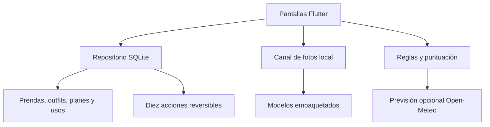

# Documentación técnica — Mi Armario 1.7.6

## Base y alcance

Código recuperado de 1.4.0, ampliado para reconstruir ocho funciones de 1.5 y las mejoras posteriores acordadas. No se dispone del fuente original de 1.5/1.6. El APK 1.6 se utiliza como referencia para identificador, certificado, esquema SQL visible y nombres de indicadores. No se presupone que esta reconstrucción sea idéntica.

## Plataforma e integraciones

Flutter 3.47.7, Dart 3.13.5, Material 3, localización española, JDK 17 y Android API 36. Entrega para ARM64 (Galaxy S23). Dependencias Dart bloqueadas en `pubspec.lock`. Android integra MediaPipe Tasks Vision 0.10.32, LiteRT 1.4.2 y ONNX Runtime Android 1.23.2; uCrop requiere OkHttp 4.12.0.

Los modelos empaquetados son EfficientNet Lite0 (clasificación general), Selfie multiclass (aislamiento) y U2NetP (fondo). No se descargan modelos en ejecución ni se transmiten fotos. EfficientNet no es un modelo especializado en moda: las etiquetas se traducen a tipos mediante reglas y se deben revisar.

Tiempo: Open-Meteo geocoding y forecast mediante HTTPS; temperatura diaria, probabilidad de lluvia y viento. `Hoy` muestra la previsión almacenada y su fecha de consulta; Ideas actualiza la previsión de la ciudad. No se consulta GPS. Dependencias/licencias: `THIRD_PARTY_NOTICES.md`, `licenses/` y manifiesto de modelos.

## Componentes

| Archivo | Responsabilidad |
|---|---|
| `main.dart`, `home.dart` | Apertura de datos, navegación Hoy/Armario/Outfits/Calendario/Ideas, filtros y copias |
| `models.dart`, `advanced_data.dart` | Modelos, selecciones, búsqueda normalizada, perfiles y validaciones |
| `repository.dart` | SQLite, integridad, CRUD, registro de usos y deshacer transaccional |
| `auto_framed_photo.dart` | Decodifica imagen reducida y calcula límites de contenido sobre fondo uniforme/transparente; dibuja subrectángulo centrado en CustomPainter, sin escribir el archivo ni modificar la base de datos. Cachea resultados en memoria, con límite aproximado. |
| `garment_editor.dart`, `batch_import_screen.dart` | Alta/edición, detección local, revisión y lotes |
| `daily_tools_screen.dart` | Prendas por revisar y lavado por selección |
| `recommendation_service.dart` | Combinaciones, puntuación y diagnóstico |
| `recommendations_screen.dart`, `outfit_draft_screen.dart`, `week_editor.dart` | Ideas, sustituciones por motivo y semana editable |
| `outfit_editor.dart`, `ui_common.dart`, `category_outfit_view.dart` | Composición guardada, gestos, ampliación y fotos por categoría |
| `advanced_tools_screen.dart`, `wardrobe_tools_screen.dart` | Vínculos, compras, historial, archivo, lotes, duplicados, maletas |
| `backup_screen.dart`, `backup_service.dart`, `outfit_image_service.dart` | Pantalla de copias con estado propio, ZIP y exportación PNG |
| `local_photo_service.dart`, `cutout_editor.dart` | Canal nativo y corrección manual de máscara |
| `android/.../LocalPhotoProcessor.kt`, `MainActivity.kt` | Clasificador, máscaras locales y comunicación Flutter/Android |

## Datos y migración

Directorio privado `wardrobe/`: `wardrobe.db` y `photos/`. Se conserva la versión de esquema 5 de la base recuperada. `onOpen` crea `undo_actions` con `IF NOT EXISTS`, sin modificar columnas anteriores.

Tablas: `garments` (foto, tipo, selecciones JSON, disponibilidad, abrigo, detalles); `outfits` (metadatos y referencia); `outfit_items` (prenda y transformación); `plans` (fecha y usado); `garment_wears` (fecha e identificador de prenda); `settings` (clima, preferencias y herramientas); `undo_actions` (id, etiqueta y estado anterior/posterior JSON). No usa tablas externas, vistas ni procedimientos almacenados.

`needs_review` y `type_review` se aceptan como indicadores booleanos en detalles. La edición conserva revisión pendiente hasta confirmar el tipo. La edición por lotes de tipo limpia ambos indicadores. Selecciones originales de texto se convierten a listas durante las migraciones ya implementadas. Los tipos se filtran por categoría en ficha y filtros; cambiar categoría reinicia el filtro de tipo.

Copias incluyen tablas principales y fotos; el diario de deshacer no se exporta. Restaurar elimina el diario dentro de la misma transacción que sustituye datos. Se conserva la validación de rutas, relaciones, campos, selecciones y límites (ZIP 250 MB; contenido 500 MB). Los datos de `action_history` de una instalación anterior no se usan como nuevas acciones de deshacer.

## Reglas nuevas

- Búsqueda AND por palabras, sin distinguir caso y vocales acentuadas. Incluye nombre, notas, categoría/tipo, talla, marca y tejido.
- Clasificador: hasta 40 etiquetas, propuestas de ropa a partir de puntuación 0,05. Se mantienen cinco tipos alternativos. Umbral de revisión 0,65; también revisión por fallo/ambigüedad. Son puntuaciones del clasificador, no probabilidades calibradas de acierto.
- Una elección de tipo confirmada manualmente no se reemplaza al repetir el análisis. El nombre editado no se sobrescribe. Los colores siguen siendo corregibles.
- Alternativas mantienen categoría funcional y capa, disponibilidad y coherencia de ocasión/vínculos. Frío exige más abrigo; otro color exige selecciones diferentes; menor formalidad evita tipos/estilos formales indicados.
- Outfits automáticos mantienen como máximo una parte inferior, un vestido y una pieza por función de capa, con las exclusiones e incompatibilidades de la base. No se cambia la transformación de composiciones guardadas por el usuario.
- Historial consulta `garment_wears`, no la composición actual del outfit. Las fotos siguen la ficha actual de la prenda; no son una captura histórica inmutable de la imagen.
- El registro de usado captura identificadores antes de posteriores cambios de outfit. Lavado es una acción separada y opcional.

## Deshacer y concurrencia

`_recordUndo` registra estados anterior/posterior dentro de la transacción de calendario o lote y retiene diez entradas. Revertir compara el estado actual del ámbito con el posterior guardado usando JSON canónico. Si hay cambios posteriores o faltan referencias originales, falla sin escribir. La semana se revierte de forma atómica y conserva outfits creados. Otros días y prendas fuera del ámbito permanecen intactos.

El diario cubre asignar/quitar/usado, guardar semana y edición por lotes. Una edición de ficha registra deshacer solo si cambia exclusivamente la disponibilidad. No se registran borrados, cambios de imágenes ni restauraciones. Las acciones no se sincronizan entre dispositivos.

## Compilación y mantenimiento

`COMPILAR_APK.ps1` exige `ARMARIO_SIGNING_KEY` como ruta externa; no copia la clave al proyecto. Gradle conserva el identificador original y usa esa clave en la entrega personal. Comparar certificado y `versionCode` con el APK instalado antes de distribuir. No activar ofuscación sin comprobar límites JNI/reflexión de los motores nativos.

Pruebas en `test/`: datos, migraciones, copias, recomendaciones y widgets; `reconstruction_test.dart` cubre ocho casos nuevos de deshacer, búsqueda y revisión. `VALIDACION.md` registra resultados reales de esta ejecución y lo que requiere móvil físico.

## Riesgos y diagnóstico

Clasificación general puede confundir pantalones con ropa superior; la mejora ofrece alternativas y revisión, no garantía de reconocimiento. El recorte de ropa puesta, memoria de modelos, Android Photo Picker, compartir y gestos requieren pruebas en S23. Las fotos pueden tener fondo o márgenes que reducen su tamaño visual aun ampliando el lienzo. Las propuestas son heurísticas, no una evaluación humana de estilo.

SQLite conserva integridad con claves externas. UI muestra errores recuperables; no hay notificaciones externas. Para fallo nativo usar Logcat y el tipo de excepción mostrado, sin publicar fotos ni secretos. Para diagnóstico de deshacer inspeccionar su ámbito, referencias y estado posterior; nunca forzar la reversión quitando la comparación. No borrar `.git` si en el futuro se incorpora un repositorio.

La vista de composición ajusta el encuadre al conjunto de prendas para aprovechar el lienzo (hasta 2,2×) y ofrece zoom a pantalla completa. El editor conserva las coordenadas y escalas guardadas. Las detecciones pendientes de confirmar se excluyen de propuestas automáticas, con explicación en Ideas.

Android usa AGP 9.1.0, Gradle 9.3.1 y el plugin Kotlin 2.4.0 aplicado explícitamente a la app. Se desactiva Kotlin integrado (`android.builtInKotlin=false`) para mantener compatibilidad con los plugins Android de Flutter. Se conserva `android.newDsl=false`; esta compatibilidad deberá revisarse al actualizar AGP o los plugins.

La navegación inicia en Hoy y su cuadrícula contiene solo fotos, con nombres accesibles mediante Semantics. Pulsación larga abre las acciones. `matchesCategoryGroup` agrupa Abrigos dentro de Parte superior para la UI; `roleOf` sigue distinguiendo exterior en las reglas de outfits. La revisión prioriza foto, nombre y tipo, permite ampliar la foto y divide datos opcionales en cuatro ExpansionTile hermanos con ancho completo. Los textos de progreso distinguen análisis, recorte y guardado. `android.builtInKotlin=false` y el plugin Kotlin explícito mantienen compatibilidad con los plugins Android de Flutter que todavía aplican Kotlin por separado.

`BackupScreen` gestiona carga, bloqueo durante exportación/restauración y actualización del recordatorio con su propio State. El traslado a Más herramientas no depende del State de la ruta anterior.

## Ajustes de interfaz posteriores a 1.7.1

- `WardrobeHome`: inicio en índice 1 (Armario); accesos Hoy e Ideas conservados. Cuadrícula con fotografías únicamente; descripción de las prendas disponible para accesibilidad y en menú contextual. Copias en Más herramientas.
- `GarmentEditor`: se deshabilita el scroll automático al expandir secciones porque desplazaba los controles y dificultaba el uso de los desplegables; las secciones conservan estado con `PageStorageKey` y `maintainState`. Se explicita que la categoría superior incluye abrigos y chaquetas sin alterar la categoría almacenada para capas/recomendaciones. Aviso contextual para tipos sin confirmar.
- No se alteran la base SQLite ni los formatos de copia.

## Evolución 1.7.3: navegación y lienzo

- `home.dart`: índices 0 Armario, 1 Outfits, 2 Ideas, 3 Hoy, 4 Calendario. El estado inicial es índice 0. «Hoy» recupera `DayPlan` de la fecha local y resuelve su `Outfit`, permitiendo elección de un conjunto guardado con `choosePlan()` o entrada al generador; se conserva el registro de uso/lavado.
- `outfit_editor.dart`: las prendas nuevas reciben coordenadas `(x,y)` normalizadas por `category` y `subtype` (superior/abrigo/inferior/calzado/vestido/accesorios); el botón de ordenar recoloca elementos existentes sin guardar hasta pulsar Guardar. La composición conserva `OutfitItem.x`, `y`, `scale` y orden de capas.
- `ui_common.dart`: silueta 2D visual de baja opacidad en edición, sin alterar eventos de gestos ni requerir recursos de red. El lienzo es de composición, no de simulación de cómo queda una prenda puesta en una persona.
- `garment_editor.dart`: mejora nominal/visual de secciones, sin eliminar los controles ni cambiar reglas de persistencia.
- Datos: sin migración, nuevas tablas ni cambios de JSON. No se alteran claves de firma ni copia de seguridad.
- Riesgos: las zonas predeterminadas son heurísticas, algunas prendas ambiguas requieren recolocación manual. Flutter y Android SDK no presentes para validación automatizada de esta iteración.

## Dos modos de composición (1.7.4)

`OutfitEditor` conserva dos listas `OutfitItem` en memoria (`items` para libre y `mannequinItems` para maniquí) con idéntico orden e identificadores. Alta, baja y cambio de capas sincronizan ambas; movimiento y escala afectan solo a la vista activa. `OutfitBoard.showFigure` controla la silueta del fondo. El maniquí inicia con `_defaultPosition` por categoría/subtipo y se puede reajustar. Al guardar/exportar se toma `visibleItems`, es decir, la vista activa. **Limitación:** SQLite solo contiene una distribución; las dos composiciones independientes no sobreviven al cierre del editor. No hay migración SQL. No es un sistema de reconocimiento corporal ni ajuste 3D.

### Ajustes de interfaz 1.7.5
`lib/home.dart`: la cuadrícula de armario usa `BoxFit.contain` para mostrar la imagen completa sin recortar. `lib/garment_editor.dart`: previsualización de 205 px y `ExpansionTile` agrupado mediante `_compactSection` para las herramientas de imagen. Los demás paneles mantienen su lógica y controles anteriores. No se modifica la base SQLite ni los métodos de guardado. La imagen puede contener márgenes transparentes o de fondo que `BoxFit.contain` no elimina automáticamente.

## Versión 1.7.6: encuadre y formulario

`AutoFramedPhoto` emplea `dart:ui` para decodificar una muestra de hasta 400 px de ancho y examinar RGBA cada dos píxeles. Solo intenta detectar los bordes si las cuatro esquinas son transparentes o de color similar. Añade margen de seguridad al rectángulo detectado y, si no hay contenido significativo, mantiene la fotografía completa. Este método heurístico no segmenta siluetas con fondos heterogéneos y puede equivocarse con una prenda del mismo color que el fondo. La imagen original nunca se modifica, ni se guardan nuevas imágenes en SQLite.

`home.dart` usa este encuadre en el mosaico y elimina el FAB de Armario/Outfits (el botón superior para añadir sigue activo). `garment_editor.dart` usa la misma presentación, separa la edición de `style`/`warmth`/`status` de `layer`/`rain`/`wind` y conserva los nombres de campos y la operación de guardado. `ui_common.dart` presenta los selectores con etiqueta independiente para evitar el solapamiento de etiquetas flotantes. La estructura de tabla y las migraciones no cambian.

**Riesgos y mantenimiento:** revisar consumo de memoria del caché de imágenes decodificadas en armarios grandes, fotografías con esquinas no homogéneas, prendas claras sobre fondos claros y orientación EXIF. El caché de visualización se renueva al reiniciar la app, no se persiste. La comprobación de pruebas Flutter y Android queda pendiente en un equipo con SDK instalado.

## Outfits 1.7.7: composición y persistencia
`OutfitEditor` conserva dos listas sincronizadas por `garmentId`: `items` (Libre) y `mannequinItems` (Maniquí). Se guardan en un solo objeto `OutfitItem` usando `x`, `y`, `scale` y `mannequinX`, `mannequinY`, `mannequinScale`. `OutfitBoard` utiliza `AutoFramedPhoto` para el encuadre visual de las prendas sin modificar el archivo original. El selector `_GarmentPicker` permite búsqueda y filtrado por categorías.

La base SQLite sube a versión 6. Una migración añade `mannequin_x`, `mannequin_y` y `mannequin_scale` a `outfit_items` sin eliminar columnas ni registros existentes. Los outfits anteriores obtienen valores predeterminados para Maniquí; se puede usar «Recolocar» para distribuirlos. La exportación de imagen sigue tomando la vista activa. El orden de capas se calcula automáticamente al añadir según el subtipo de prenda, y «Traer al frente» permite modificarlo manualmente.
